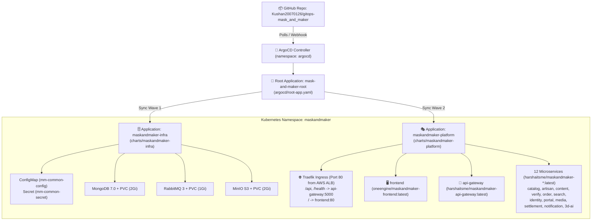

# ☸️ Mask & Maker — GitOps Repository (ArgoCD + Helm on K3s)

Declarative **GitOps Continuous Delivery (CD)** repository for the **Mask & Maker** Sri Lankan heritage mask marketplace, designed for **ArgoCD** on our 3-node **AWS Free Tier K3s Kubernetes Cluster**.

---

## 1. GitOps Architecture (App-of-Apps Pattern)



---

## 2. Repository Structure

| Path | Description |
|---|---|
| `argocd/project.yaml` | ArgoCD `AppProject` (`mask-and-maker`) scoping cluster & namespace permissions. |
| `argocd/root-app.yaml` | ArgoCD **App-of-Apps** root manifest watching `argocd/applications/`. |
| `argocd/applications/infrastructure-app.yaml` | **Sync Wave 1**: Deploys `charts/maskandmaker-infra` (MongoDB, RabbitMQ, MinIO, ConfigMap, Secret). |
| `argocd/applications/microservices-app.yaml` | **Sync Wave 2**: Deploys `charts/maskandmaker-platform` (Frontend, API Gateway, 12 Microservices, Traefik Ingress). |
| `charts/maskandmaker-infra/` | Helm chart for stateful backing services and shared configuration. |
| `charts/maskandmaker-platform/` | Helm chart for all stateless application workloads and Traefik Ingress routing. |
| `scripts/bootstrap-argocd.sh` | One-command bootstrap script to install ArgoCD on the K3s Master node and register the Root App. |

---

## 3. Container Images Deployed

| Service | Docker Hub Image | Port |
|---|---|---|
| **Frontend (React + Nginx)** | `oneengine/maskandmaker-frontend:latest` | `80` |
| **API Gateway** | `harshaitsme/maskandmaker-api-gateway:latest` | `5000` |
| **Catalog Service** | `harshaitsme/maskandmaker-catalog-service:latest` | `3001` |
| **Artisan Service** | `harshaitsme/maskandmaker-artisan-service:latest` | `3002` |
| **Content Service** | `harshaitsme/maskandmaker-content-service:latest` | `3003` |
| **Verify Service** | `harshaitsme/maskandmaker-verify-service:latest` | `3004` |
| **Order Service** | `harshaitsme/maskandmaker-order-service:latest` | `3005` |
| **Search Service** | `harshaitsme/maskandmaker-search-service:latest` | `3006` |
| **Identity Service** | `harshaitsme/maskandmaker-identity-service:latest` | `3007` |
| **Portal Service** | `harshaitsme/maskandmaker-portal-service:latest` | `3008` |
| **Media Service** | `harshaitsme/maskandmaker-media-service:latest` | `3009` |
| **Settlement Service** | `harshaitsme/maskandmaker-settlement-service:latest` | `3010` |
| **Notification Service** | `harshaitsme/maskandmaker-notification-service:latest` | `3011` |
| **3D AI Service (TripoSR)** | `harshaitsme/maskandmaker-3d-ai-service:latest` | `8000` |

---

## 4. Quick Start on K3s Master Node

SSH into your K3s Master node and run:

```bash
# Option A: One-command bootstrap script
curl -fsSL https://raw.githubusercontent.com/Kushan20070126/gitops-mask_and_maker/main/scripts/bootstrap-argocd.sh | bash

# Option B: Manual kubectl apply (if ArgoCD is already installed)
sudo kubectl apply -f https://raw.githubusercontent.com/Kushan20070126/gitops-mask_and_maker/main/argocd/project.yaml
sudo kubectl apply -f https://raw.githubusercontent.com/Kushan20070126/gitops-mask_and_maker/main/argocd/root-app.yaml
```

### Verify Sync & Pods
```bash
sudo kubectl get applications -n argocd
sudo kubectl get pods -n maskandmaker -o wide
sudo kubectl get ingress -n maskandmaker
```
